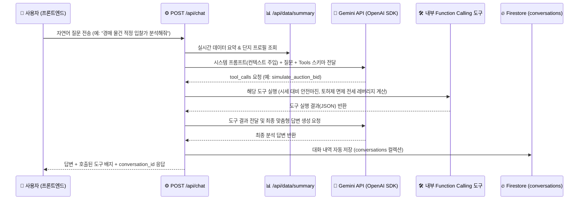

# 🏠 나만의 AI 부동산 시세 & 매매 타이밍 비서

> **개포우성8차 & 개포현대3차(통합재건축) 시계열 실거래가 · 전세 동향 · 정부정책/교통호재 · 경매 포착 데이터를 분석하여 매매 시기를 진단하는 컨텍스트 주입형 AI 웹 서비스**

---

## 1. 서비스 소개 (무엇을 해결하는지)
일반적인 LLM(ChatGPT, Gemini 등)에게 *"개포우성8차랑 현대3차 지금 매수 타이밍 어때? 경매 나온 거 있어?"*라고 질문하면, 내가 추적 중인 실제 시계열 실거래 데이터나 최근 전세가 지지선, 진행 중인 경매 사건을 알지 못해 원론적인 답변만 제공합니다.

본 프로젝트는 아래 문제를 해결합니다:
1. **정확한 단지 기본 프로필 & 통합재건축 연관성 탑재**:
   - **개포우성8차** (개포동 179 / 개포로 411, 1987.09 준공, 최고 9층, 3개 동 261세대, 전용 79㎡ 단일 위주, 용적률 192%, 평균 대지지분 14.4평)
   - **개포현대3차** (개포동 177 / 개포로 409, 1986.03 준공, 최고 9층, 5개 동 198세대, 전용 84·131·163㎡ 중대형 위주, 용적률 147%, 평균 대지지분 30.5평)
   - 두 단지가 맞닿아 추진 중인 **총 459세대 통합재건축(대지지분 차이에 따른 '독립정산제' 핵심 이슈)** 연관성을 기본 탑재했습니다.
2. **119개 이상의 시계열 데이터 분리 분석 (`/api/data/summary`)**:
   - 매매 실거래가(`value`)를 중심으로 평균·최고·최저·중앙값·표준편차·트렌드를 계산하되, 매매 시기의 선행 지표인 **전세가 흐름(전세가율 약 38~40%)**을 메모 컨텍스트로 결합했습니다.
   - 특히 유찰된 **경매 최저입찰가(`[경매매물]`)**나 **`[정부정책]` / `[교통호재]`** 이벤트가 일반 매매 평균가를 왜곡하지 않도록 백엔드 요약 엔진에서 **자동 분리 집계**합니다.
3. **자유로운 대상 단지 확장성**:
   - 데이터 추가 시 `[대치은마]`, `[개포우성7차]` 등 새로운 단지명을 입력하면 코드 수정 없이 **자동으로 새 단지 탭과 단지별 통계, 차트, AI 컨텍스트가 즉시 확장**됩니다.
4. **원클릭 스마트 알림 배지 UX**:
   - 평소에는 화면이 복잡하지 않도록 상단에 **3대 알림 사인(`🔗 통합재건축 프로필`, `📢 정책·교통호재`, `🚨 경매 포착`)**만 심플하게 표시하고, 클릭 시 상세 브리핑 팝업과 원클릭 AI 입찰/정책 분석을 제공합니다.

---

## 2. 기술 스택 (Tech Stack)
- **Backend**: Python 3.10+, FastAPI, Uvicorn, Pydantic v2, `python-dotenv`
- **AI Engine**: Google **Gemini API** (`gemini-2.5-flash` — 공식 `openai` Python SDK 호환 엔드포인트 연동 + Function Calling 도구 4종 탑재)
- **Database**: Google **Firebase Firestore** (`firebase-admin` — `data`, `conversations` 컬렉션 CRUD + 미설정 시 로컬 JSON 스토어 자동 폴백)
- **Frontend**: Vanilla **HTML5 / CSS3 / JavaScript (ES6+)** (프레임워크 미사용), **Chart.js** (시계열 시각화)
- **Deployment**: **Render** (Backend Web Service), **Vercel** (Frontend Static Hosting)

---

## 3. 배포 URL
- **프론트엔드 (Vercel)**: `https://your-project-name.vercel.app` *(배포 후 업데이트)*
- **백엔드 API (Render)**: `https://your-backend-name.onrender.com` *(배포 후 업데이트)*
- **Swagger UI API 문서 (`/docs`)**: `https://your-backend-name.onrender.com/docs` *(로컬: `http://localhost:8000/docs`)*

---

## 4. 프로젝트 폴더 구조 및 분리 기준
```text
M1-2/
├── main.py                         # 루트 실행 엔트리포인트 (uvicorn main:app --reload)
├── requirements.txt                # 파이썬 의존성 패키지 목록
├── render.yaml                     # Render 배포 설정 파일
├── .env.example                    # 환경변수 템플릿
├── backend/
│   ├── main.py                     # FastAPI 앱 초기화, CORS 설정, 정적 파일 및 헬스체크
│   ├── config.py                   # 환경변수 로드 및 설정 클래스
│   ├── seed_data.py                # 개포우성8차 & 현대3차 단지 프로필 + 119건 시계열 초기 데이터
│   ├── models/
│   │   └── schemas.py              # Pydantic 요청/응답 데이터 검증 스키마
│   ├── routers/
│   │   ├── data_router.py          # /api/data CRUD (4개) + /api/data/summary + /api/data/statistics
│   │   ├── conversations_router.py # /api/conversations 대화 저장/목록/상세불러오기/삭제
│   │   └── chat_router.py          # /api/chat (컨텍스트 주입 + Function Calling) + /api/news
│   └── services/
│       ├── firebase_service.py     # Firestore 연동 및 data/conversations 컬렉션 CRUD
│       ├── analytics_service.py    # 시계열 통계, 단지별 자동 분리, 경매/정책 분리 요약 엔진
│       └── ai_service.py           # 시스템 프롬프트 컨텍스트 주입, Gemini 연동, 내부 도구 4종 실행
└── frontend/
    ├── index.html                  # 바닐라 HTML 대시보드 & 3대 알림 모달
    ├── styles.css                  # 반응형 스타일 및 다크모드 테마
    ├── app.js                      # API 통신, 차트 렌더링, CRUD, CSV/JSON 다운로드 로직
    └── vercel.json                 # Vercel 배포 설정
```

---

## 5. 로컬 실행 방법

### 1) 가상환경 생성 및 패키지 설치
```bash
python3 -m venv venv
source venv/bin/activate
pip install -r requirements.txt
```

### 2) 환경 변수 설정 (`.env`)
```bash
cp .env.example .env
```
`.env` 파일을 열어 발급받은 **Gemini API 키**와 **Firebase 서비스 계정 키 경로(또는 JSON)**를 입력합니다.
*(※ 키를 입력하기 전에도 내장된 119건 로컬 스토어 및 스마트 분석 엔진을 통해 에러 없이 즉시 전체 화면과 기능을 테스트할 수 있습니다!)*

### 3) 백엔드 & 프론트엔드 통합 실행
```bash
uvicorn main:app --reload --port 8000
```
- **웹 서비스 화면 접속**: [http://localhost:8000](http://localhost:8000)
- **Swagger UI (`/docs`) 확인**: [http://localhost:8000/docs](http://localhost:8000/docs)

---

## 6. 환경 변수 목록 (최소 세트)

| 변수명 | 설명 | 예시 |
| :--- | :--- | :--- |
| `GEMINI_API_KEY` | Google AI Studio에서 발급받은 Gemini API 키 | `AIzaSy...` |
| `FIREBASE_SERVICE_ACCOUNT_PATH` | 로컬 개발 시 Firebase 서비스 계정 JSON 키 파일 경로 | `./serviceAccountKey.json` |
| `FIREBASE_SERVICE_ACCOUNT_JSON` | Render 배포 시 서비스 계정 JSON 문자열 원본 | `{"type":"service_account",...}` |
| `ALLOWED_ORIGINS` | CORS 허용 도메인 목록 (쉼표 구분 또는 `*`) | `https://my-app.vercel.app,http://localhost:8000` |
| `API_BASE_URL` | 프론트엔드에서 호출할 백엔드 서버 주소 | `http://localhost:8000` |

---

## 7. 보너스 과제: AI 도구 호출(Function Calling) 근거 및 호출 흐름

사용자의 자연어 질문 의도에 따라 LLM(Gemini)이 단순 요약만으로 부족할 때 아래 **4가지 내부 도구(`AI_TOOLS_SCHEMA`)** 중 적합한 도구를 스스로 선택해 호출합니다.



### 등록된 4대 도구 및 호출 근거
1. `simulate_auction_bid`: 질문에 **경매, 입찰, 유찰, 낙찰, 토허제 면제** 관련 키워드가 있을 때 호출하여 감정가 대비 최저입찰가 안전마진과 전세 레버리지 실투자금을 시뮬레이션합니다.
2. `get_integrated_redevelopment_analysis`: 질문에 **통합재건축, 독립정산제, 대지지분, 용적률, 층수** 비교가 필요할 때 호출하여 건축물대장 정밀 스펙을 조회합니다.
3. `search_complex_records`: 특정 단지명이나 연도, 평형별 상세 실거래 내역 검색이 필요할 때 호출합니다.
4. `fetch_realtime_estate_news`: 최신 **정부 부동산 정책, 토지거래허가구역, GTX 교통호재** 뉴스 확인이 필요할 때 Google News RSS를 실시간 검색합니다.

---

## 8. 제출 스크린샷 안내
1. **데이터 요약이 보이는 채팅 화면** (질문 + AI 답변 + 상단 요약 카드 포함)
2. **데이터 관리 화면** (`date`, `value`, `memo` 추가/수정/삭제 동작 확인)
3. **대화 기록 화면** (`이전 대화 기록` 서랍에서 특정 대화 클릭 시 불러오기 동작 확인)

